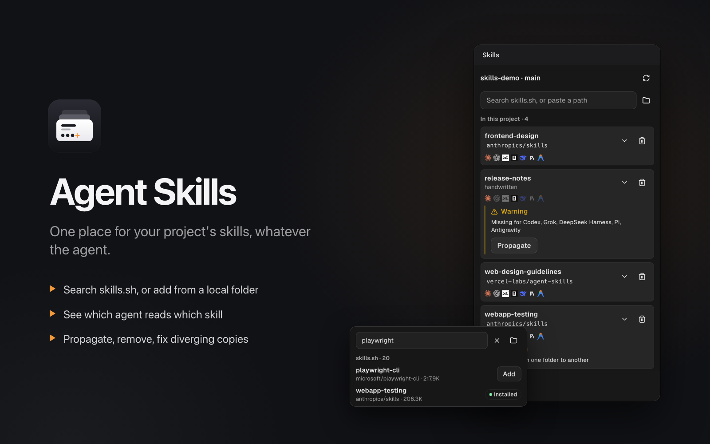

# Agent Skills

**Manage the skills of the open project for every agent Orca runs: search skills.sh, add from a repo or a local folder, remove, and see which agent reads which skill.**

  

[Install](#install) · [Features](#features) · [Where skills are written](#where-skills-are-written) · [Access](#what-it-can-access) · [Platforms](#platforms) · [Limits](#requirements-and-limits) · [Development](#development)



Every coding agent reads project skills from its own folder: `.claude/skills` for Claude, `.agents/skills` for Codex, Pi, Antigravity and DeepSeek Harness, `.grok/skills` for Grok, and so on. Adding a skill by hand means copying it into the right folders, and nothing tells you which agent is blind to it. Agent Skills adds a **Skills** panel that follows the focused workspace, lists the skills of the project and shows, per skill, which of your agents can see it (the ones Orca's history has seen, plus those whose config folder exists, see [Which agents appear](#platforms)).

## Install

```sh
orca plugin install eRom/orca-plugin-agent-skills
```

Orca shows the access the plugin asks for (see [What it can access](#what-it-can-access)) and enables it once you approve. The panel appears in the right sidebar under the puzzle icon.

## Features

- **One field does everything.** Empty, it lists the skills of the project. Type two characters or more and it searches [skills.sh](https://skills.sh), sorted by installs. Paste a path (`/`, `~`, `./` or `../`; on Windows also a drive path such as `C:\...`, and `.\`, `..\` or `~\`) and it offers to add from that folder. The folder button opens the macOS picker; on Linux and Windows there is no folder button, paste the path.
- **One icon per active agent on each skill**: full when the agent sees the skill, faded when it does not. Hover an icon to see which folder gives the agent the skill. The icons only display.
- **Choose your agents**: the plugin detects your agents: those Orca's history has seen, plus those whose config folder exists. The agent button in the panel header lists them, each with a switch: a hidden agent loses its icons and an addition no longer writes for it, in every project (a folder that another active agent reads is still written). The last visible agent cannot be hidden.
- **Propagate**: when an active agent does not see a skill, a warning says which ones, and one click copies the skill into the folder each of them reads.
- **Add** from a skills.sh result or a local folder (a pasted path, or the folder button). A typed `owner/repo` is a search, not an add: pick the result you want. A source holding several skills opens a checklist, everything ticked by default.
- **Remove** a skill with the trash icon of its row: it goes from every folder the plugin manages, after a confirmation, and each copy goes to the Trash. There is no per-folder or per-agent removal: to keep a skill for some agents only, hide the other agents (see **Choose your agents**).
- **Diverging copies** (the same skill, different content in two folders): the row says so, shows one version per distinct content, and **Keep this one** copies it over the others. Nothing is written before you choose.
- **Replace safely**: adding a skill whose name already exists asks first, and the current copy goes to the Trash.
- **Worktrees**: the panel follows the focused workspace. In a non-main worktree it reminds you that a skill added there reaches the other worktrees only once committed.

The panel speaks Orca's language: French when Orca is set to French, English otherwise. Orca hands a panel its language only when the panel opens, so after changing Orca's language, close and reopen the panel to switch.

## Where skills are written

The plugin only reads, lists, writes and removes in ten **managed folders** of the project:

`.agents/skills`, `.claude/skills`, `.grok/skills`, `.kiro/skills`, `.qoder/skills`, `.codebuddy/skills`, `.zcode/skills`, `.trae/skills`, `.openclaude/skills`, `.prime/agent/skills`.

An addition writes into the **fewest folders** that cover your active agents, not into every folder skills.sh could attribute. With Claude, Codex, Grok, OpenCode, Pi, Antigravity and DeepSeek Harness active, that is `.claude/skills`, `.agents/skills` and `.grok/skills`.

- **Only verified reads count.** The table of which agent reads which folder (`docs/agent-skill-dirs.md`) comes from primary sources (official docs, the agents' own repositories). A read that could not be verified is treated as absent: one copy too many beats a blind agent.
- **The root `skills/` folder is never touched.** Some agents read it, but it is also where a repository publishes its own skill sources, and listing it would offer to remove the repository's content.
- **Folders that agents read but the plugin does not manage** (`.cursor/skills`, `.codex/skills`, `.github/skills`, `.gemini/skills`, `.opencode/skills`...) are ignored: a skill that exists only there is not listed.
- **Aider** reads no skills and never appears.
- **No active agent** (none of Orca's agents found on your computer, or every one found is hidden): the plugin writes into `.agents/skills` and `.claude/skills`, which cover 35 of Orca's 45 agents, shows no agent icons, and says which case it is in one line.
- A `skills-lock.json` is written at the root of the project by additions, as the `skills` CLI does. Propagate and the copies into folders the library does not know (`.openclaude`, `.prime`) leave it alone.

### Symbolic links and safety

- A skill that is a **link to another copy of the project** (`.claude/skills/x -> ../../.agents/skills/x`, the form the `skills` CLI creates in its default mode) is the same copy as its target, never a divergence.
- A skill that is a **link to outside the project** is marked as an external link. Its content is never written nor trashed: removing it moves only the link.
- A skills folder whose real path **leaves the workspace** (for example `.claude -> ~/.claude`) is refused with a red banner: no write, no removal in it.
- **Nothing is deleted for good.** Before any removal or overwrite, each distinct version goes to the system Trash (`/usr/bin/trash` on macOS 15 and later; on older macOS the destructive gestures are refused), and without a verified Trash the destructive gestures are refused with a message (see [Platforms](#platforms)).
- Every guard is computed on the disk read at the moment of the gesture, never on the list in memory.

## What it can access

Orca labels this plugin **Full access**: it runs its own worker process on your machine with your user's rights. Here is exactly what it does with that.

| Capability | Why |
| --- | --- |
| `workspace:read` | Know the focused workspace (path, branch, project, host) to list and manage its skills. |
| `storage:own` | Keep the hidden agents in the plugin's own storage. |
| `history:read` | Since 0.2: learn which agent each past session of yours used, to know which agents you really run. It reads only the agent name of each session, never titles or conversations, and stores none of it. |

Beyond Orca's API, the worker:

- **never reads** Orca's own files: the agents come from Orca's session history (the capability above), then from the config folders listed under [Platforms](#platforms), the choices from the plugin's storage.
- **runs** `/usr/bin/osascript` for the folder picker and `/usr/bin/trash` for the Trash on macOS (shipped with macOS 15 and later). Linux will use `gio trash` once verified; today removing is refused there. It starts no shell to detect agents.
- **writes** only in the project's managed folders listed above and in `skills-lock.json` at its root.
- **makes network requests** to skills.sh for the search (`GET https://skills.sh/api/search`), and, through the [`skills`](https://github.com/vercel-labs/skills) library, to the git host of a repository you add from.

### Telemetry of the `skills` library

The plugin embeds the `skills` library, the engine of the `skills` CLI. By default the library sends **anonymous usage telemetry** on a successful install or removal, as the CLI does. **The plugin turns it off** on every call it makes to the library, so nothing is sent from the plugin, and it collects nothing of its own. What the library collects when it is on: [library documentation](https://github.com/vercel-labs/skills/blob/main/docs/troubleshooting.md#telemetry).

## Platforms

Since 0.2 the plugin runs on macOS, Linux and Windows. What differs:

| | Trash (removing, replacing) | Folder button |
| --- | --- | --- |
| **macOS** | Verified: `/usr/bin/trash`, shipped with macOS 15 and later (on older macOS, removing and replacing are refused). | Opens the macOS picker. |
| **Linux** | Experimental: `gio trash` is wired but not verified yet, so removing is unavailable until the Trash is verified. Adding works. | None: paste a path. |
| **Windows** | Experimental, not yet played on a real Windows machine. Adding works, removing and replacing are not available yet. | None: paste a path. |

Without a verified Trash the plugin refuses every gesture that would delete or overwrite, because nothing is ever deleted for good.

**WSL and network workspaces** on Windows: a raw Linux path received on Windows (a WSL distribution's root) is not supported, the panel says so and offers no gesture. A UNC workspace (`\\wsl$\...`, `\\server\share\...`) works for reading, adding and propagating; only the destructive gestures (remove, replace, keep this version) are refused, because there is no Trash on a network path.

**Which agents appear.** The plugin first asks Orca's session history which agents you used: an agent shows up after its first session in Orca. For agents the history cannot tell, it falls back to the config folder each agent creates in your home. A config folder moved elsewhere (`PI_CONFIG_DIR` for OMP, `DSH_HOME`, `XDG_CONFIG_HOME`...) is not followed: those users still get the agent once it appears in Orca's history.

Two agents have no config folder the plugin can check, and are not offered until they appear in the history:

- **Detected only from Orca's history:** OpenCode 2, Muse.
- **Not detected:** none at the moment. (Aider reads no skills, and Claude Agent Teams is covered by the Claude row.)

## Requirements and limits

- **Orca 1.4.259 or later.**
- **Remote workspaces** (SSH, runtime hosts) are not supported: the panel says so and offers no gesture. The home folder is refused as a project.
- **No plugin API lists Orca's enabled agents**, so the plugin cannot tell which agents you turned off in Orca's Settings > Agents: it shows the agents Orca's history has seen and those whose config folder exists, and you hide the ones you do not want with the agent button. An agent that has a session in Orca while the panel is open shows up on ⟳; one detected by its config folder, once that folder exists.
- **The panel does not watch the disk.** It re-reads on open, on workspace change, after each gesture, and on ⟳.
- **Two agents read project skills only after you approve the folder** (Hermes: `hermes skills trust`; Mistral Vibe: trusted folder). The row says so in its expanded view.
- **No update command yet.** The lock keeps what is needed (source, type, hash); updating from the lock is planned for 1.x.
- **skills.sh search uses an undocumented API**, the one the `skills` CLI uses. If it changes, the panel shows "skills.sh is not answering".
- **Reading folders:** the table of agent reads must be re-verified before each release as agents change.

## Development

```sh
bun install            # dependencies (the library is pinned to an exact version)
bun run typecheck      # bunx tsc -p .
orca plugin test .     # node:test with orca/testing
bun run build          # bundles src/worker.ts into dist/worker.mjs
bun run check:dist     # rebuilds and fails if dist/ is not up to date
```

`dist/` is committed: Orca loads `dist/worker.mjs`, which embeds the `skills` library and its dependencies. `node_modules/` is not committed. Licences of the embedded dependencies: [THIRD-PARTY.md](THIRD-PARTY.md).

To try a change in Orca, load a frozen copy rather than the repository (Orca ties its approval to the content of the whole folder):

```sh
git archive HEAD | tar -x -C /path/to/copy
orca plugin dev load /path/to/copy
```

## License

MIT, see [LICENSE](LICENSE). Third-party licences: [THIRD-PARTY.md](THIRD-PARTY.md).
